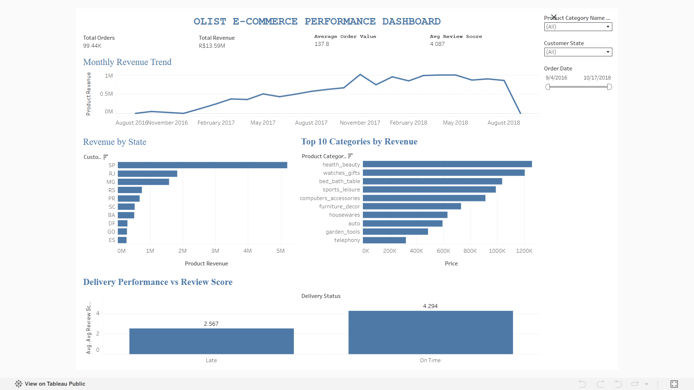

# Olist E-Commerce Analysis

## Project Overview

This project analyzes the Brazilian Olist e-commerce dataset to evaluate sales performance, customer behavior, delivery performance, payment patterns, seller performance, and product category trends.

The project covers the complete analytics workflow from raw CSV files to SQL analysis and an interactive Tableau dashboard.

The main goal was to transform raw transactional data into clear business insights that could support decision-making.

---

## Business Objectives

The analysis focuses on answering questions such as:

- How did revenue and order volume change over time?
- Which product categories generated the most revenue?
- Which Brazilian states contributed the most to sales?
- How did delivery delays relate to customer review scores?
- Which sellers generated the highest revenue?
- Which payment methods were most commonly used?
- How common were repeat customers?

---

## Dataset

The project uses the Brazilian Olist E-Commerce Public Dataset.

Main tables used:

- `customers`
- `orders`
- `order_items`
- `order_payments`
- `order_reviews`
- `products`
- `sellers`
- `category_translation`

The geolocation dataset was intentionally excluded because it was not required for the business questions addressed in this project.

---

## Data Model

The dataset contains multiple levels of granularity.

Examples:

- `orders`: one row per order
- `order_items`: one row per order item
- `order_payments`: one row per payment record
- `order_reviews`: one or more reviews per order
- `customers`: one customer record associated with an order

An important part of the analysis was controlling row multiplication when joining tables with different grains.

For example, joining order items and payments directly at the order level could inflate revenue or transaction counts.

Aggregations were therefore performed before certain joins when necessary.

---

## Tools Used

- **MySQL** — data storage, profiling, cleaning, analysis, and analytical views
- **SQL** — joins, aggregations, CTEs, subqueries, and business analysis
- **Tableau Public** — interactive dashboard and visualization
- **Excel** — initial analytical practice and validation

---

## Project Workflow

### 1. Database Setup

The raw CSV files were imported into MySQL and organized into relational tables.

### 2. Data Profiling

The dataset was examined for:

- Duplicate records
- Missing values
- Invalid dates
- Unexpected categorical values
- Primary and logical key uniqueness
- Orphan records
- Data range anomalies

### 3. Data Cleaning

Cleaning included:

- Correct date conversion
- Removing trailing characters from state fields
- Cleaning category translation values
- Validating duplicate and logical keys
- Documenting unresolved anomalies instead of modifying valid records without evidence

### 4. Business Analysis

SQL queries were created to analyze:

- Monthly revenue and order trends
- Product category performance
- Geographic performance
- Delivery performance and customer reviews
- Seller performance
- Payment behavior
- Repeat customer behavior

### 5. Analytical Views

Three SQL views were created for Tableau:

- `vw_order_summary`
- `vw_item_analysis`
- `vw_payment_analysis`

Each view has a clearly defined grain to reduce aggregation errors in the dashboard.

### 6. Tableau Dashboard

The final Tableau dashboard includes:

- Total Revenue
- Total Orders
- Average Order Value
- Average Review Score
- Monthly Revenue Trend
- Revenue by State
- Top Product Categories by Revenue
- Delivery Performance vs Review Score
- Interactive Date, State, and Category filters

---

## Key KPIs

| KPI | Result |
|---|---:|
| Total Product Revenue | ~R$13.59M |
| Total Orders | ~99.44K |
| Average Order Value | ~R$137.8 |
| Average Review Score | ~4.09 |
| Repeat Customer Rate | ~3.12% |

---

## Key Insights

### Revenue Trend

Revenue showed an overall upward trend during the main period of the dataset, with strong growth throughout 2017.

The decline visible near the end of 2018 should be interpreted carefully because the final period of the dataset is incomplete.

### Product Categories

Health & Beauty generated the highest product revenue.

Category revenue was influenced by both sales volume and average product price.

### Geographic Performance

São Paulo generated the highest total revenue and had the largest order volume.

However, high revenue did not necessarily mean the highest Average Order Value.

### Delivery Performance

Orders delivered on time had an average review score of approximately **4.29**, compared with approximately **2.57** for late deliveries.

This shows a strong association between delivery performance and customer satisfaction.

### Seller Performance

Seller revenue was not driven only by sales volume.

Some sellers generated similar revenue levels with significantly fewer orders, indicating higher-value transactions.

### Payment Behavior

Credit cards were the dominant payment method, accounting for the majority of payment transactions and payment value.

### Customer Retention

Only around **3.12%** of unique customers placed more than one valid order, indicating relatively low repeat purchasing within the available dataset.

More detailed findings are available in:

`docs/insights.md`

---

## Dashboard

The interactive dashboard is available on Tableau Public:

**[View Tableau Dashboard](tableau/dashboard-link.md)**

### Dashboard Preview



---

## Repository Structure

```text
olist-ecommerce-analysis/
│
├── README.md
│
├── sql/
│   ├── 01_schema.sql
│   ├── 02_data_profiling.sql
│   ├── 03_data_cleaning.sql
│   ├── 04_business_analysis.sql
│   └── 06_views.sql
│
├── docs/
│   ├── data_dictionary.md
│   ├── erd.png
│   └── insights.md
│
├── tableau/
│   └── dashboard-link.md
│
└── images/
    └── dashboard.png